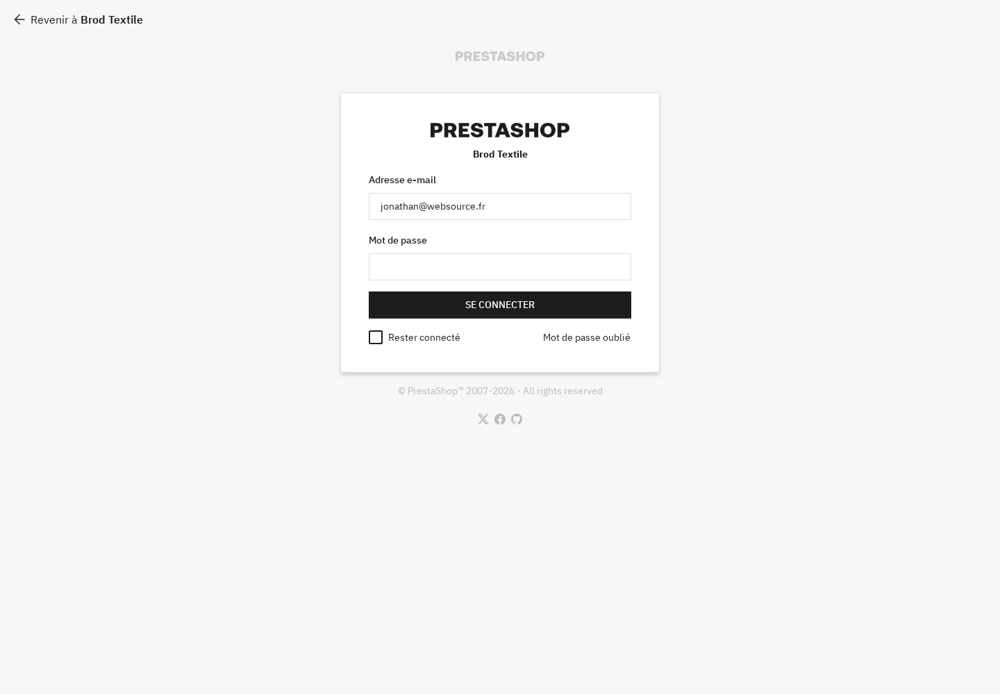
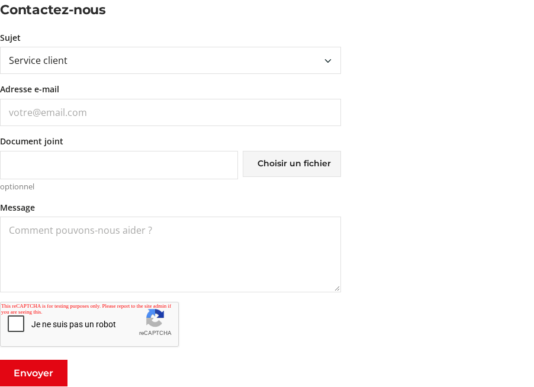
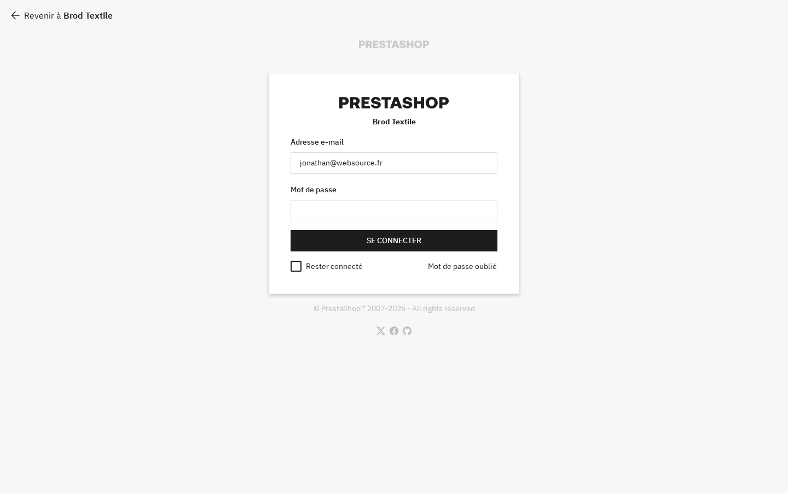

# Websource reCAPTCHA — Guide utilisateur

Module PrestaShop gratuit édité par [Websource](https://www.websource.fr).
Version du guide : 1.0.0 — compatible PrestaShop 1.7.8 à 9.x, PHP 7.2 à 8.5.

Ce guide s'adresse aux marchands : aucune compétence technique n'est nécessaire pour installer et configurer le module. Les passages sur les sélecteurs CSS concernent les thèmes personnalisés et peuvent être transmis à votre prestataire.

## Sommaire

1. [À quoi sert reCAPTCHA ?](#1-à-quoi-sert-recaptcha-)
2. [Choisir sa version : v2, v2 invisible ou v3](#2-choisir-sa-version--v2-v2-invisible-ou-v3)
3. [Créer ses clés Google](#3-créer-ses-clés-google)
4. [Installer le module](#4-installer-le-module)
5. [Configurer le module](#5-configurer-le-module)
6. [Choisir les formulaires protégés](#6-choisir-les-formulaires-protégés)
7. [Tester les clés](#7-tester-les-clés)
8. [Statistiques et journal](#8-statistiques-et-journal)
9. [RGPD et cookies](#9-rgpd-et-cookies)
10. [Masquer le badge : règles Google](#10-masquer-le-badge--règles-google)
11. [Dépannage et FAQ](#11-dépannage-et-faq)
12. [Désinstallation](#12-désinstallation)

---

## 1. À quoi sert reCAPTCHA ?

Les formulaires d'une boutique (contact, création de compte, newsletter, avis produits…) sont la cible permanente de robots qui envoient des messages publicitaires, créent de faux comptes ou testent des mots de passe volés. Conséquences : boîte de réception saturée, base clients polluée, fausses inscriptions newsletter qui dégradent la délivrabilité de vos e-mails, voire comptes clients compromis.

**reCAPTCHA** est un service gratuit de Google qui distingue les visiteurs humains des robots. Le module Websource reCAPTCHA :

- ajoute automatiquement la protection aux formulaires que vous choisissez, sans modifier votre thème ;
- **vérifie chaque envoi côté serveur** auprès de Google, avant que PrestaShop ne traite le formulaire : un robot qui contourne le JavaScript est bloqué quand même ;
- affiche un message d'erreur clair dans le formulaire en cas de blocage, sans page blanche, en conservant la saisie quand PrestaShop le permet ;
- compte les envois validés et bloqués sur 7 et 30 jours, et tient un journal détaillé des échecs.

Le module ne modifie aucun fichier du cœur de PrestaShop (aucune « override »).

---

## 2. Choisir sa version : v2, v2 invisible ou v3

Google propose trois variantes. Le module les gère toutes ; vous en choisissez **une** pour l'ensemble de la boutique (champ **Version**).

| | **reCAPTCHA v2 — case « Je ne suis pas un robot »** | **reCAPTCHA v2 — invisible** | **reCAPTCHA v3 — score (sans interaction)** |
|---|---|---|---|
| Ce que voit le visiteur | Une case à cocher, parfois une grille d'images à résoudre | Rien en général ; un défi d'images apparaît seulement si Google a un doute | Rien : aucune interaction, jamais de défi |
| Élément affiché | Le widget dans le formulaire | Un badge reCAPTCHA (coin de l'écran ou intégré) | Un badge reCAPTCHA (coin de l'écran ou intégré) |
| Fonctionnement | Le visiteur coche la case | Analyse au clic sur le bouton d'envoi | Note de 0,0 (robot) à 1,0 (humain), comparée au **Seuil v3** |
| Si Google a un doute | Défi d'images | Défi d'images | **Envoi refusé, sans défi de rattrapage** : le visiteur voit un message d'erreur |
| Confort pour le client | Moyen (un clic de plus, parfois un défi) | Bon | Excellent, sauf pour les rares visiteurs mal notés |
| Recommandé pour | Boutiques très ciblées par le spam, protection visible | La plupart des boutiques : bon compromis | Boutiques qui privilégient la conversion et surveillent leurs statistiques |

**Notre conseil** : la version proposée à l'installation est la **v2 case à cocher**, la plus prévisible. Pour un parcours plus fluide, passez en **v2 invisible**. Choisissez la **v3** (seuil 0,5) si vous acceptez qu'un visiteur jugé suspect soit refusé sans possibilité de prouver qu'il est humain.

> **Important** : une clé Google est liée à une version. Une clé v3 ne fonctionne pas en v2, une clé v2 case à cocher ne fonctionne pas en v2 invisible. Si vous changez de version dans le module, créez de nouvelles clés du type correspondant (voir section 3).

---

## 3. Créer ses clés Google

Il vous faut deux clés : une **clé du site** (publique, utilisée dans la page) et une **clé secrète** (privée, utilisée par votre serveur pour interroger Google). La création est gratuite.

### Pas à pas

1. Connectez-vous avec un compte Google (idéalement un compte de l'entreprise, pas un compte personnel) sur la console d'administration reCAPTCHA : <https://www.google.com/recaptcha/admin>.
2. Cliquez sur **« + »** (Créer) pour enregistrer un nouveau site.
3. **Libellé** : un nom pour vous repérer, par exemple « Ma boutique — production ».
4. **Type de reCAPTCHA** — choisissez **exactement** celui qui correspond à la version que vous sélectionnerez dans le module :

   | Version choisie dans le module | Type à choisir chez Google |
   |---|---|
   | reCAPTCHA v2 — case « Je ne suis pas un robot » | **reCAPTCHA v2** (ou « Challenge (v2) ») → **Case à cocher « Je ne suis pas un robot »** |
   | reCAPTCHA v2 — invisible | **reCAPTCHA v2** (ou « Challenge (v2) ») → **Badge reCAPTCHA invisible** |
   | reCAPTCHA v3 — score | **reCAPTCHA v3** (ou « Basée sur les scores (v3) ») |

5. **Domaines** : saisissez le nom de domaine de votre boutique **sans** `https://` ni chemin, par exemple `ma-boutique.fr`. Un domaine couvre ses sous-domaines (`www.ma-boutique.fr`). Ajoutez sur des lignes séparées :
   - les autres domaines de la boutique (multiboutique, domaines par langue) ;
   - votre site de préproduction, si vous en avez un (`preprod.ma-boutique.fr`) ;
   - `localhost` uniquement si vous testez sur un poste local.
6. Acceptez les conditions d'utilisation, puis cliquez sur **Envoyer**.
7. Google affiche la **clé du site** et la **clé secrète**. Elles ressemblent à `6Lxxxxxxxxxxxxxxxxxxxxxxxxxxxxxxxxxxxxxx` (40 caractères commençant généralement par `6L`). Copiez-les : vous les collerez dans le module.

> Google peut vous demander d'associer vos clés à un projet **Google Cloud**. C'est normal depuis l'évolution de reCAPTCHA vers Google Cloud ; l'usage reste gratuit dans la limite des quotas publiés par Google (largement suffisants pour une boutique). Si votre console n'affiche que la clé du site, la clé secrète se trouve dans les détails de la clé, rubrique « Utiliser la clé ancienne » / *legacy key*.

**Sécurité** : ne communiquez jamais votre clé secrète par e-mail ou dans un ticket public. Si elle a fuité, régénérez-la depuis la console Google et remplacez-la dans le module.

---

## 4. Installer le module

1. Téléchargez le fichier `websourcerecaptcha-1.0.0.zip` depuis la page des versions du dépôt GitHub : <https://github.com/Websource-fr/websourcerecaptcha/releases>. **Ne décompressez pas** le fichier.
2. Dans le back-office PrestaShop, ouvrez **Modules > Gestionnaire de modules**.
3. Cliquez sur **Téléverser un module** (en haut à droite), puis déposez le fichier zip.
4. PrestaShop installe le module ; cliquez sur **Configurer**.

Vous retrouverez ensuite la configuration dans **Modules > Gestionnaire de modules**, en cherchant « Websource reCAPTCHA », bouton **Configurer**.

> Tant que la clé du site et la clé secrète ne sont pas renseignées, le module ne bloque rien (un avertissement le rappelle en haut de la page de configuration) : vous pouvez l'installer sans risque sur une boutique en production.

---

## 5. Configurer le module

La page de configuration comporte cinq blocs de réglages (**Clés et version de reCAPTCHA**, **Formulaires protégés**, **Exclusions**, **Consentement cookies**, **Journal**), chacun avec son bouton **Enregistrer**, puis les blocs **Tester les clés**, **Statistiques** et **Journal des échecs**.

### 5.1 Clés et version de reCAPTCHA

| Option | Effet | Valeur conseillée |
|---|---|---|
| **Protection active** | Interrupteur général. Sur Non, plus aucun formulaire n'est contrôlé. | Oui |
| **Version** | reCAPTCHA v2 — case « Je ne suis pas un robot », reCAPTCHA v2 — invisible, ou reCAPTCHA v3 — score (sans interaction). Détermine l'affichage et le type de clé attendu. | v2 case à cocher (défaut) ou v2 invisible |
| **Clé du site** | Clé publique fournie par Google, utilisée dans le navigateur. | Votre clé `6L…` |
| **Clé secrète** | Clé privée utilisée par le serveur. Elle n'est jamais réaffichée ni transmise au navigateur. **Laissez le champ vide pour conserver la clé enregistrée.** | Votre clé `6L…` |
| **Effacer la clé secrète enregistrée** | Supprime la clé secrète à l'enregistrement (la protection s'arrête alors). | Non |
| **Seuil v3** | Score minimal accepté, de 0.0 (tout accepter) à 1.0 (très strict). Un envoi dont le score est inférieur est refusé, sans défi de rattrapage. | 0.5 (défaut). 0.7 si du spam passe ; 0.3 si des clients sont bloqués |
| **Thème (v2)** | Widget Clair ou Sombre. | Clair, sauf thème à fond sombre |
| **Taille (v2 case à cocher)** | Normale ou Compacte (utile dans une colonne étroite). | Normale |
| **Position du badge (invisible / v3)** | En bas à droite, En bas à gauche, ou Intégré au formulaire. | En bas à droite ; à gauche si un bouton de chat occupe déjà le coin droit |
| **Masquer le badge** | Cache le badge et ajoute dans chaque formulaire protégé la mention légale Google. Voir section 10. Sans effet en v2 case à cocher. | Non |
| **Contrôler le nom d'hôte** | Refuse les jetons émis sur un autre domaine que ceux de la boutique (protection contre la réutilisation de votre clé sur un autre site). À laisser désactivé avec les clés de test Google. | Non (défaut) ; Oui une fois la boutique en production |
| **Laisser passer si Google est injoignable** | Oui : en cas de panne ou de délai dépassé (5 s), les formulaires restent utilisables. Non : les envois sont bloqués tant que Google ne répond pas. | Oui (défaut) |

À l'enregistrement, le module signale une clé qui ne ressemble pas à une clé reCAPTCHA (40 caractères attendus) et refuse un seuil hors de l'intervalle 0.0–1.0.

### 5.2 Exclusions

| Option | Effet | Valeur conseillée |
|---|---|---|
| **Ne pas protéger pour les clients connectés** | Les clients identifiés ne voient pas reCAPTCHA et leurs envois ne sont pas contrôlés. | Oui (défaut : Non) |
| **Adresses IP autorisées** | Adresses jamais contrôlées, une adresse ou un bloc CIDR par ligne (ex. `192.168.1.10`, `10.0.0.0/8`, `2001:db8::/32`). Votre adresse actuelle est rappelée sous le champ. Les lignes invalides sont ignorées et signalées. | Votre IP de bureau, si elle est fixe |
| **Ne pas protéger pour les IP de maintenance** | Reprend les adresses saisies dans **Paramètres de la boutique > Général > Maintenance**. | Oui si vous y avez déclaré vos IP (défaut : Non) |

### 5.3 Consentement cookies

| Option | Effet | Valeur conseillée |
|---|---|---|
| **Charger reCAPTCHA après consentement** | Le script Google n'est chargé qu'après accord du visiteur. Sans accord, le formulaire affiche le message « Ce formulaire est protégé contre le spam par Google reCAPTCHA. Pour l'envoyer, autorisez le chargement de ce service. » et un bouton **Autoriser reCAPTCHA**. Voir section 9. | Non (défaut) |
| **Catégorie Websource Cookie Consent** | Catégorie du module Websource Cookie Consent dont l'acceptation vaut accord : Services, Préférences, Mesure d'audience ou Marketing. | Services (défaut) |
| **Événement JavaScript générique** | Facultatif : nom d'un événement déclenché sur `document` ou `window` par un autre outil de consentement (ex. `recaptcha:consent`). Votre outil peut aussi définir `window.wsrcConsentGranted = true`. | Vide, sauf autre outil de consentement |

Avec Websource Cookie Consent, rien d'autre à faire : le module écoute son événement `wsconsent:update` et interroge son API à chaque page.

### 5.4 Journal

| Option | Effet | Valeur conseillée |
|---|---|---|
| **Journaliser les échecs** | Enregistre chaque envoi refusé : date, formulaire, adresse IP anonymisée, score et codes d'erreur. Purge automatique après 30 jours. Les compteurs restent disponibles même désactivé. | Oui (défaut) |

### Multiboutique

Les réglages sont enregistrés pour le contexte de boutique sélectionné en haut du back-office : vous pouvez donc utiliser des clés différentes par boutique. Les statistiques et le journal sont propres à chaque boutique.

---

## 6. Choisir les formulaires protégés

Le bloc **Formulaires protégés** liste huit formulaires, tous activés à l'installation. Pour chacun : un interrupteur, un **Sélecteur CSS** et, en v3, une **Action v3**. Si le module correspondant est absent ou désactivé, la mention « Module … absent ou désactivé : protection inactive » s'affiche et le réglage est sans effet.

| Formulaire (libellé dans le module) | Page ou module concernés | Conseil |
|---|---|---|
| **Formulaire de contact** | Page « Contactez-nous » (module *contactform*) | À activer : principale cible du spam |
| **Création de compte** | Page d'inscription client | À activer : évite les faux comptes |
| **Connexion** | Page de connexion et onglet « Se connecter » du tunnel | À activer : freine le piratage de comptes |
| **Mot de passe oublié** | Page de réinitialisation | À activer : évite l'envoi massif d'e-mails |
| **Newsletter (ps_emailsubscription)** | Bloc newsletter standard de PrestaShop | À activer : protège votre réputation d'expéditeur |
| **Newsletter (Websource Newsletter)** | Module *websourcenewsletter*, s'il est installé | Idem |
| **Avis produits (productcomments)** | Formulaire d'avis du module *productcomments* | À activer si vous recevez de faux avis |
| **Commande invité (tunnel de commande)** | Création du compte invité dans le tunnel | À activer, puis tester une commande complète |

Pour limiter l'impact sur les performances, le script Google n'est chargé que si un formulaire protégé est présent dans la page ; pour la newsletter et les avis produits, seulement quand le visiteur clique dans le formulaire.

### Sélecteur CSS (thème personnalisé)

Le module repère chaque formulaire grâce à un **sélecteur CSS**. La valeur par défaut est rappelée sous le champ (« Par défaut : … ») ; un champ vidé reprend cette valeur à l'enregistrement. Plusieurs sélecteurs peuvent être séparés par des virgules.

| Formulaire | Sélecteur par défaut |
|---|---|
| Formulaire de contact | `.contact-form form` |
| Création de compte | `#customer-form` |
| Connexion | `#login-form` |
| Mot de passe oublié | `form.forgotten-password` |
| Newsletter (ps_emailsubscription) | `.block_newsletter form` |
| Newsletter (Websource Newsletter) | `form[data-wsnl-form]` |
| Avis produits (productcomments) | `#post-product-comment-form` |
| Commande invité (tunnel de commande) | `#checkout-guest-form #customer-form` |

Ces valeurs conviennent au thème **Classic** et au thème **Websource**. Pour le thème **Hummingbird** (thème par défaut de PrestaShop 9) ou un thème personnalisé, aucune valeur spécifique n'est fournie : renseignez les sélecteurs vous-même (méthode en section [11](#le-widget-napparaît-pas-sur-un-formulaire-hummingbird-ou-thème-personnalisé)).

La vérification côté serveur s'applique quel que soit le sélecteur. Un sélecteur incorrect ne laisse donc pas passer les robots : il **bloque les vrais clients**, car leur envoi arrive sans jeton. Testez chaque formulaire après modification.

Les formulaires rechargés sans recharger la page (AJAX : bloc newsletter, tunnel de commande…) sont pris en charge.

### Action v3

En v3, chaque formulaire transmet à Google un nom d'action (`contact`, `signup`, `login`, `password_reset`, `newsletter`, `product_review`, `guest_checkout`). Le serveur vérifie que le jeton a bien été généré pour ce formulaire, et la console Google affiche les scores par action. Conservez les valeurs par défaut (lettres, chiffres, `_` et `/` uniquement).

---

## 7. Tester les clés

Le bloc **Tester les clés** propose deux tests. Aucun des deux n'enregistre la configuration. Le test complet utilise les valeurs saisies dans le formulaire (vous pouvez donc tester des clés avant de cliquer sur **Enregistrer**) ; le test rapide utilise la clé secrète enregistrée.

### 7.1 Lancer le test complet (recommandé)

Cliquez sur **Lancer le test complet**. Le navigateur obtient un vrai jeton auprès de Google avec la **clé du site** et la **version** saisies dans le formulaire, puis le serveur le fait vérifier avec la **clé secrète** (celle saisie, sinon celle enregistrée). En v2 case à cocher, cochez la case qui apparaît.

Ce test contrôle à la fois le couple de clés, leur type et le domaine autorisé :

| Résultat affiché | Signification |
|---|---|
| « Clés valides : le jeton a été vérifié par Google. » (+ score en v3) | Tout est correct |
| « Les clés fonctionnent mais ce sont des clés v2 alors que la version v3 est sélectionnée. » (ou l'inverse) | Changez la version ou créez des clés du bon type |
| « Jeton refusé (« invalid-input-response ») : la clé secrète ne correspond pas à la clé du site. » | Les deux clés ne viennent pas de la même paire |
| « Clé secrète refusée par Google (« invalid-input-secret ») » | Vous avez probablement collé la clé du site à la place de la clé secrète |
| « Aucun jeton obtenu de Google : vérifiez la clé du site, son type… et la liste des domaines autorisés » | Clé du site erronée, type incorrect ou domaine non déclaré chez Google |
| « Impossible de charger le script Google reCAPTCHA » | Connexion ou bloqueur de publicité de votre navigateur |
| « Google est injoignable depuis le serveur » | Votre hébergement bloque les connexions sortantes vers Google : contactez votre hébergeur |

### 7.2 Test rapide de connexion à Google

Le bouton **Test rapide de connexion à Google** interroge Google depuis le serveur, sans jeton. Il vérifie que le serveur joint Google et détecte la **clé secrète de test publique** de Google (message « Clé secrète de test Google détectée : tous les jetons sont acceptés. Ne l'utilisez pas en production. »). Il ne peut pas confirmer qu'une clé secrète est valide, car Google donne désormais la même réponse quelle que soit la clé : utilisez pour cela le test complet.

### 7.3 Test réel en navigation privée

Le test en navigation privée garantit que vous êtes vu comme un visiteur non connecté.

1. Ouvrez une fenêtre de navigation privée et allez sur la page **Contactez-nous** de la boutique.
2. Vérifiez la présence de la case (v2) ou du badge (v2 invisible / v3). Aucun message rouge « ERREUR pour le propriétaire du site » ne doit apparaître.
3. Envoyez un message de test : il doit arriver normalement.
4. Répétez pour la création de compte, la newsletter et, si activée, une commande en invité.
5. Si votre IP figure dans les **Adresses IP autorisées** ou les IP de maintenance exclues, testez depuis une autre connexion (partage de connexion de votre téléphone, par exemple).

Pour vérifier le blocage en v2 case à cocher : envoyez le formulaire sans cocher la case. Le message « Merci de cocher la case « Je ne suis pas un robot » avant d'envoyer le formulaire. » doit s'afficher.

---

## 8. Statistiques et journal

### Statistiques

Le bloc **Statistiques** affiche quatre compteurs (**Envois bloqués — 7 jours**, **Envois bloqués — 30 jours**, **Envois validés — 7 jours**, **Envois validés — 30 jours**) puis un tableau par formulaire (Bloqués 7 j, Validés 7 j, Bloqués 30 j, Validés 30 j). Ces compteurs sont agrégés par jour, sans aucune donnée personnelle, et restent disponibles même si le journal est désactivé.

### Journal des échecs

Le bloc **Journal des échecs (50 dernières entrées)** liste pour chaque envoi refusé : la date, le formulaire, l'adresse IP **anonymisée** (IPv4 tronquée au /24, ex. `203.0.113.0` ; IPv6 tronquée au /48), le score (v3), les codes d'erreur et le résultat :

- **Bloqué** : l'envoi a été refusé ;
- **Laissé passer (Google injoignable)** : Google n'a pas répondu et l'option **Laisser passer si Google est injoignable** est active.

Les entrées de plus de 30 jours sont supprimées automatiquement. Le bouton **Vider le journal** efface immédiatement le journal de la boutique (après confirmation).

### Lire les codes d'erreur

| Code | Signification |
|---|---|
| `missing-input-response` | Aucun jeton envoyé : robot qui n'exécute pas le JavaScript, case non cochée, ou sélecteur CSS qui ne correspond pas au formulaire |
| `invalid-input-response` | Jeton invalide ou falsifié, ou clé secrète qui ne correspond pas à la clé du site (si toutes les lignes l'indiquent, lancez le test complet) |
| `timeout-or-duplicate` | Jeton expiré (formulaire laissé ouvert plus de 2 minutes) ou déjà utilisé |
| `invalid-input-secret` | Clé secrète refusée par Google |
| `low-score` | v3 : score inférieur au **Seuil v3** |
| `action-mismatch` | v3 : le jeton a été généré pour un autre formulaire |
| `score-missing` | v3 sélectionnée mais jeton v2 reçu : clés du mauvais type |
| `hostname-mismatch` | Jeton émis sur un autre domaine (option **Contrôler le nom d'hôte**) |

Un journal qui se remplit de `missing-input-response` et de `low-score` alors que les envois validés continuent est le signe que la protection fonctionne.

---

## 9. RGPD et cookies

### Base légale

reCAPTCHA est un dispositif de **sécurité** : il protège la boutique et ses clients contre les abus (faux comptes, piratage, spam). Son usage peut reposer sur l'**intérêt légitime** (article 6.1.f du RGPD), comme d'autres dispositifs de sécurité. C'est pourquoi l'option **Charger reCAPTCHA après consentement** est **désactivée par défaut**.

reCAPTCHA transmet cependant à Google des données techniques (adresse IP, informations sur le navigateur, cookies Google) et les autorités de protection des données n'ont pas toutes la même lecture. Deux approches sont possibles :

| Approche | Réglage | Conséquence |
|---|---|---|
| **Intérêt légitime** (défaut) | Charger reCAPTCHA après consentement = Non | Protection active pour tous ; mention obligatoire dans votre politique de confidentialité |
| **Consentement préalable** | Charger reCAPTCHA après consentement = Oui | Le script n'est chargé qu'après accord (bandeau Websource Cookie Consent, autre outil via l'événement générique, ou bouton **Autoriser reCAPTCHA** affiché dans le formulaire). L'accord donné par ce bouton est mémorisé dans le navigateur. Sans accord, le formulaire ne peut pas être envoyé |

Le choix vous appartient ; en cas de doute, rapprochez-vous de votre DPO ou de votre conseil. Dans tous les cas, le script Google n'est chargé que sur les pages contenant un formulaire protégé.

### Paragraphe type pour votre politique de confidentialité

À adapter puis ajouter dans votre page « Politique de confidentialité » (**Design > Pages**) :

> **Protection contre le spam (Google reCAPTCHA)**
>
> Afin de protéger notre site et nos clients contre les envois automatisés (spam, création de faux comptes, tentatives de connexion frauduleuses), certains formulaires (contact, création de compte, connexion, mot de passe oublié, newsletter, avis, commande sans compte) utilisent le service reCAPTCHA fourni par Google Ireland Limited, Gordon House, Barrow Street, Dublin 4, Irlande.
>
> Ce service analyse des informations techniques (adresse IP, données de navigation, caractéristiques du navigateur et de l'appareil, cookies Google) afin de déterminer si l'envoi provient d'une personne ou d'un programme automatisé. Ces données peuvent être transférées vers les États-Unis ; Google adhère au cadre de protection des données UE–États-Unis (Data Privacy Framework).
>
> Ce traitement repose sur notre intérêt légitime à assurer la sécurité de notre site (article 6.1.f du RGPD). Le script n'est chargé que sur les pages comportant un formulaire protégé. Pour les envois refusés, notre site conserve uniquement la date, le formulaire concerné, l'adresse IP tronquée et le résultat de la vérification, pendant 30 jours au maximum.
>
> Pour en savoir plus : [Règles de confidentialité de Google](https://policies.google.com/privacy) et [Conditions d'utilisation de Google](https://policies.google.com/terms).

Si vous activez le chargement après consentement, remplacez la phrase sur la base légale par : « Ce traitement repose sur votre consentement, que vous pouvez retirer à tout moment depuis le bandeau de gestion des cookies. »

---

## 10. Masquer le badge : règles Google

En v2 invisible et v3, Google affiche un petit badge flottant. Google **autorise** à le masquer **à condition** d'afficher clairement, dans le parcours de l'utilisateur, une mention avec les liens vers ses règles.

Lorsque vous activez **Masquer le badge**, le module ajoute automatiquement dans chaque formulaire protégé la mention (traduite selon la langue) :

> Ce site est protégé par reCAPTCHA : les [règles de confidentialité](https://policies.google.com/privacy) et les [conditions d'utilisation](https://policies.google.com/terms) de Google s'appliquent.

**Ne masquez pas le badge par du CSS dans votre thème** sans afficher cette mention : c'est contraire aux conditions de Google.

---

## 11. Dépannage et FAQ

### « ERREUR pour le propriétaire du site : type de clé non valide »

Le type de clé créé chez Google ne correspond pas à la version choisie dans le module (par exemple clé v3 utilisée en v2, ou clé v2 case à cocher utilisée en v2 invisible). Vérifiez le tableau de la [section 3](#3-créer-ses-clés-google) : changez la **Version** dans le module ou créez de nouvelles clés du bon type. Une clé ne peut pas changer de type après sa création. Le **test complet** signale aussi ce cas.

### « ERREUR pour le propriétaire du site : domaine non valide pour la clé de site »

Le domaine de la page n'est pas déclaré pour cette clé. Dans la console Google, ouvrez les paramètres de la clé et ajoutez le domaine exact de la boutique (sans `https://`). Pensez aux domaines secondaires (multiboutique, préproduction). La prise en compte peut prendre jusqu'à 30 minutes.

### Le formulaire est bloqué pour tout le monde

Tous les envois échouent, y compris les vôtres :

1. Cliquez sur **Lancer le test complet** : il détecte une clé secrète qui ne correspond pas, un mauvais type de clé ou un domaine non déclaré.
2. Regardez les codes du **Journal des échecs** (tableau section 8). En v3, si de vrais clients ont des scores proches du seuil (`low-score`), abaissez le **Seuil v3** à 0.3.
3. `missing-input-response` sur un seul formulaire : son **Sélecteur CSS** ne correspond pas au thème (voir ci-dessous).
4. Videz le cache (voir ci-dessous) : un ancien JavaScript en cache peut ne plus envoyer le jeton.
5. Un module de cookies ou un bloqueur empêche le chargement du script Google : autorisez reCAPTCHA dans ce module, ou activez **Charger reCAPTCHA après consentement** pour que le visiteur puisse l'autoriser depuis le formulaire.
6. En dernier recours, désactivez la protection du formulaire concerné le temps du diagnostic, puis contactez-nous avec les codes du journal.

### Le widget n'apparaît pas sur un formulaire (Hummingbird ou thème personnalisé)

Les sélecteurs par défaut sont prévus pour les thèmes Classic et Websource. Sur Hummingbird ou un autre thème :

1. Ouvrez la page du formulaire, clic droit sur le formulaire → **Inspecter**.
2. Repérez la balise `<form>` et notez un identifiant ou une classe caractéristique (ex. `id="contact-form"` ou `class="js-customer-form"`).
3. Dans **Formulaires protégés**, remplacez le **Sélecteur CSS** du formulaire par `form#contact-form` ou `form.js-customer-form` (plusieurs sélecteurs séparés par des virgules si besoin).
4. Enregistrez, videz le cache et testez en navigation privée.

Si le sélecteur ne désigne aucun formulaire de la page, rien n'est inséré et le serveur refuse les envois ; s'il en désigne plusieurs, chacun est protégé. Votre intégrateur peut vous aider.

### Vider le cache (CCC)

Après l'installation, une mise à jour du module ou un changement de sélecteur, videz les caches :

1. **Paramètres avancés > Performances** → bouton **Vider le cache**.
2. Si l'option **CCC** (Combine, Compress and Cache) est active pour le JavaScript et le CSS, le vidage du cache régénère les fichiers combinés. En cas de doute, désactivez temporairement CCC le temps du test.
3. Videz aussi le cache de votre CDN ou de votre module de cache de pages (s'il y en a un), puis rechargez la page en navigation privée.

### Limites connues

- **Envois par JavaScript sans événement « submit »** : si un thème ou un module envoie un formulaire protégé par script sans passer par l'envoi normal du formulaire, le module ne peut pas y ajouter le jeton et le serveur refuse l'envoi. Solution : désactiver la protection de ce formulaire ou faire adapter le script.
- **Commande invité sous PrestaShop 1.7.8** : en cas d'échec de la vérification, le formulaire d'informations personnelles est réaffiché vide (PrestaShop 1.7.8 ne fournit pas de point d'accroche permettant de conserver la saisie). Les versions 8 et 9 conservent la saisie.
- **v2 case à cocher et formulaires AJAX** : après un envoi AJAX (newsletter, avis…), la case est réinitialisée environ 1,5 seconde plus tard, car un jeton ne sert qu'une fois. Pour un nouvel envoi, le visiteur coche de nouveau la case.
- **v3** : un visiteur dont le score est trop bas est refusé sans défi de rattrapage ; il voit un message d'erreur et peut réessayer.

### Compatibilité

| Élément | Compatibilité |
|---|---|
| PrestaShop | 1.7.8 à 9.x (testé sur 9.2) |
| PHP | 7.2 à 8.5 |
| Thèmes | Classic et thème Websource (sélecteurs fournis) ; Hummingbird et autres thèmes via les sélecteurs CSS à renseigner |
| Modules de formulaires | contactform, ps_emailsubscription, websourcenewsletter, productcomments |
| Consentement cookies | Websource Cookie Consent (événement `wsconsent:update`), tout autre outil via l'événement générique ou `window.wsrcConsentGranted` |
| Hébergement | Connexions sortantes HTTPS vers `www.google.com` (cURL ou `allow_url_fopen` ; un avertissement s'affiche si aucun n'est disponible) |
| Multiboutique | Réglages selon le contexte de boutique, statistiques et journal par boutique |

Le module n'utilise aucune override et ne modifie aucun fichier du cœur. Évitez d'activer deux modules de captcha sur le même formulaire.

### Autres questions

**Le module ralentit-il ma boutique ?** Le script Google est chargé en différé (`async defer`), uniquement si un formulaire protégé est présent, et pour la newsletter et les avis seulement au premier clic dans le formulaire. La vérification serveur n'intervient qu'au moment de l'envoi.

**Puis-je l'utiliser sans compte Google ?** Non, les clés sont délivrées par Google. Un compte Google gratuit suffit.

**reCAPTCHA s'affiche dans quelle langue ?** Dans la langue de la page consultée par le visiteur.

**Mes clients connectés voient-ils reCAPTCHA ?** Oui par défaut ; non si vous activez **Ne pas protéger pour les clients connectés**.

**Le spam continue d'arriver.** Vérifiez que le formulaire concerné est activé et que son module est bien détecté, que les messages ne passent pas par un autre canal (adresse e-mail publiée en clair, autre module de formulaire). En v3, relevez le seuil ; sinon passez en v2.

---

## 12. Désinstallation

Dans **Modules > Gestionnaire de modules**, recherchez « Websource reCAPTCHA » puis, dans le menu du module :

- **Désactiver** : la protection est suspendue, les réglages, statistiques et journal sont conservés. Vous pouvez aussi passer **Protection active** sur Non dans la configuration ;
- **Désinstaller** : PrestaShop demande « Supprimer la configuration, le journal et les statistiques reCAPTCHA ? ». La désinstallation supprime toute la configuration (y compris les clés), les tables du journal et des statistiques, et détache le module de ses points d'accroche. Vos formulaires reviennent à leur fonctionnement d'origine.

Après désinstallation, videz le cache (**Paramètres avancés > Performances**). Vous pouvez aussi supprimer la clé correspondante dans la console Google si vous ne l'utilisez plus.

---

## Support

- Signaler un problème ou proposer une amélioration : <https://github.com/Websource-fr/websourcerecaptcha/issues>
- Besoin d'aide pour l'intégration, un thème sur mesure ou votre boutique PrestaShop : [Websource, agence PrestaShop](https://www.websource.fr/agence-prestashop)

Module distribué sous licence AFL-3.0 — © Websource — <https://www.websource.fr>
